# Examen de DAW

### Instancias Borradas
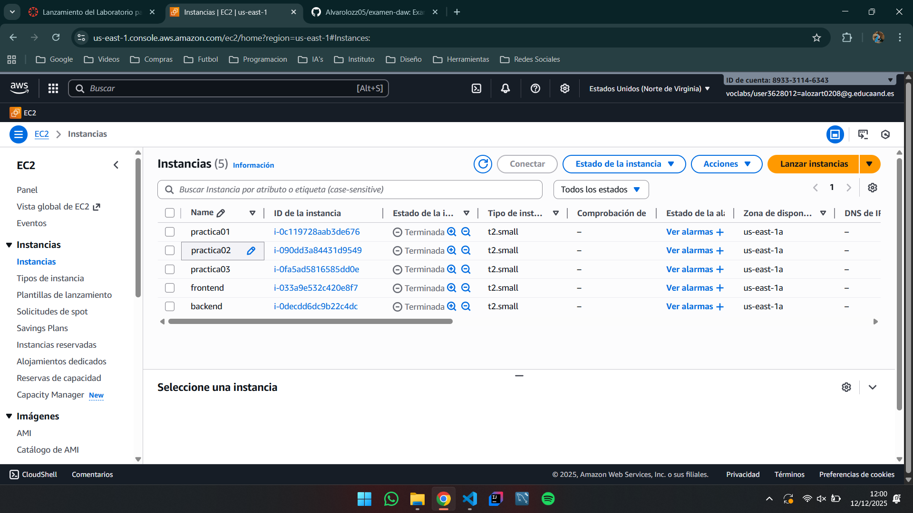

### IP Elasticas Borradas
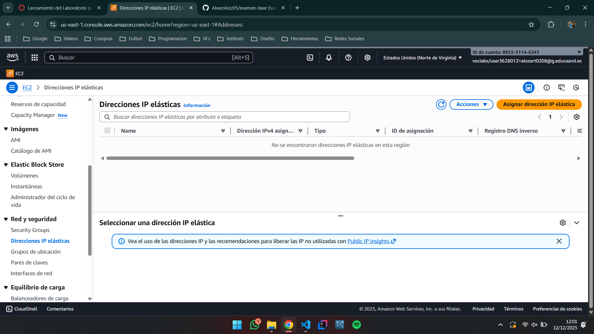

### Grupos de Seguridad Borrados
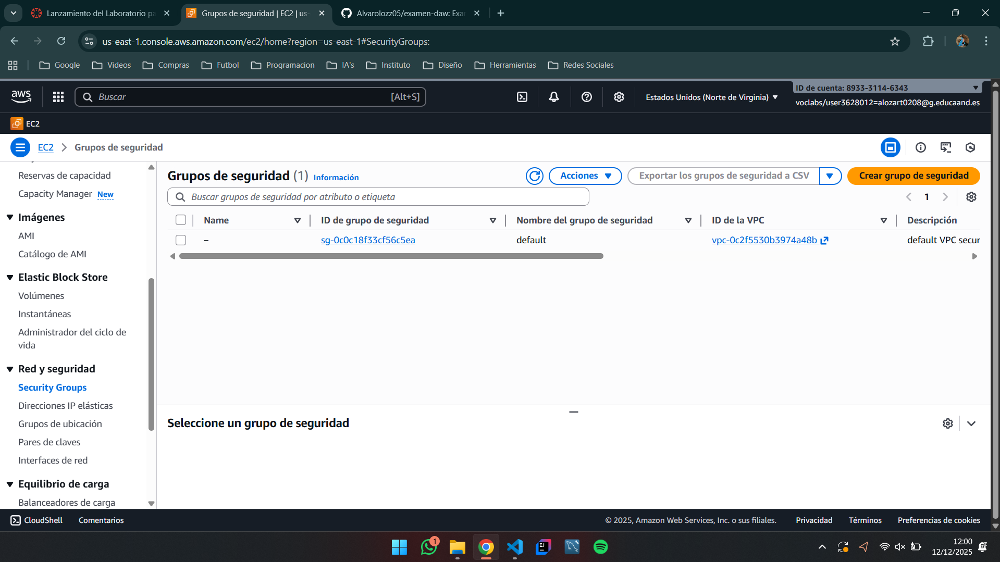

### SG_BACKEND
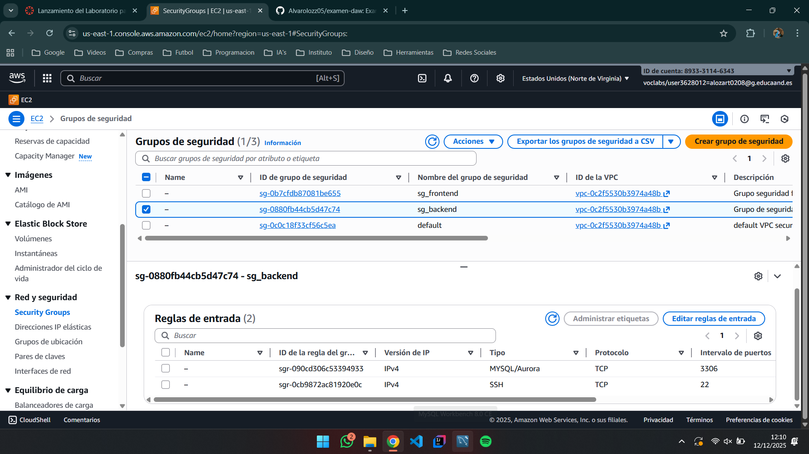

### SG_FRONTEND
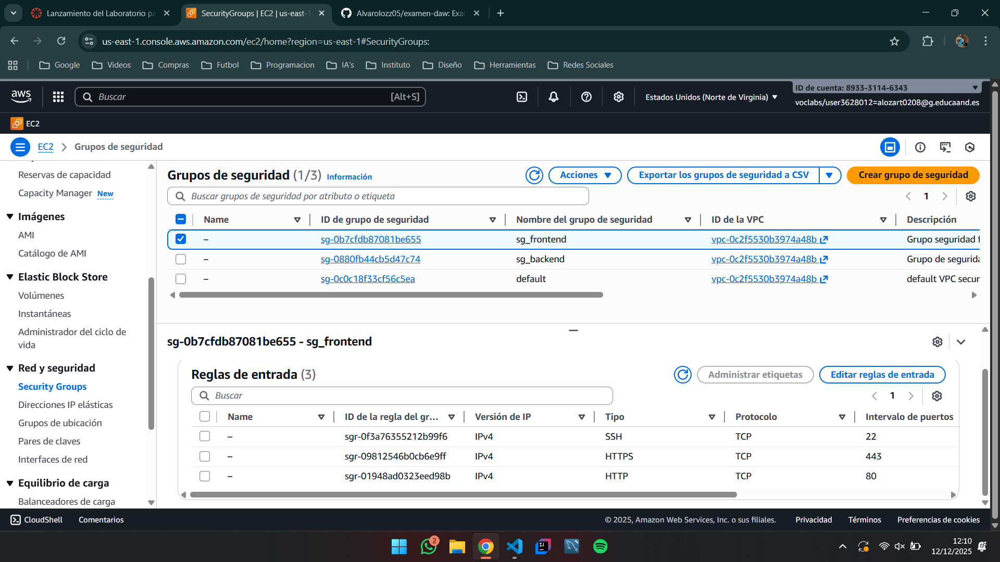

## Creación del Dominio
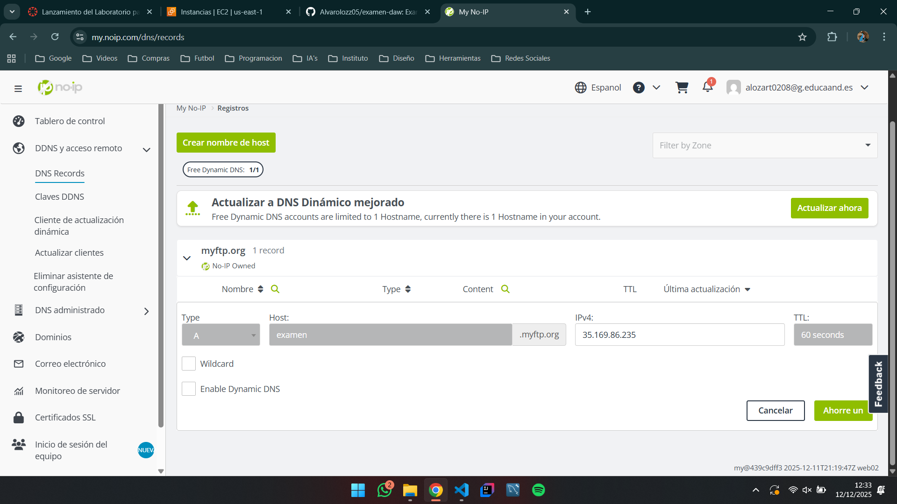

### Install_Lamp_Backend
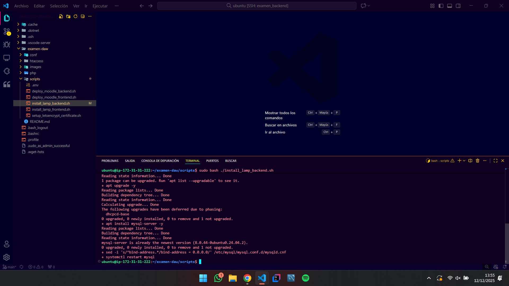

### Deploy_Moodle_Backend
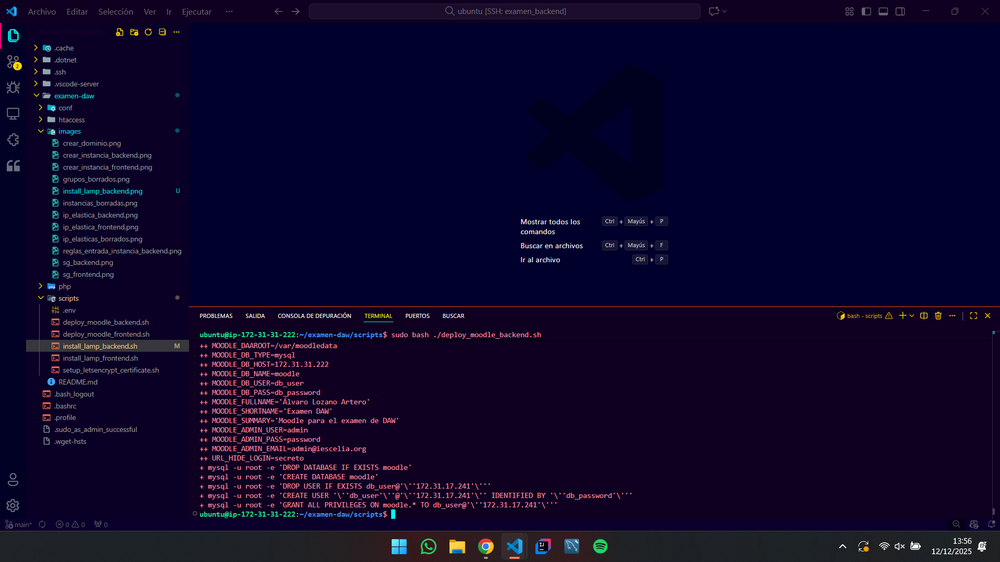

### Install_Lamp_Frontend
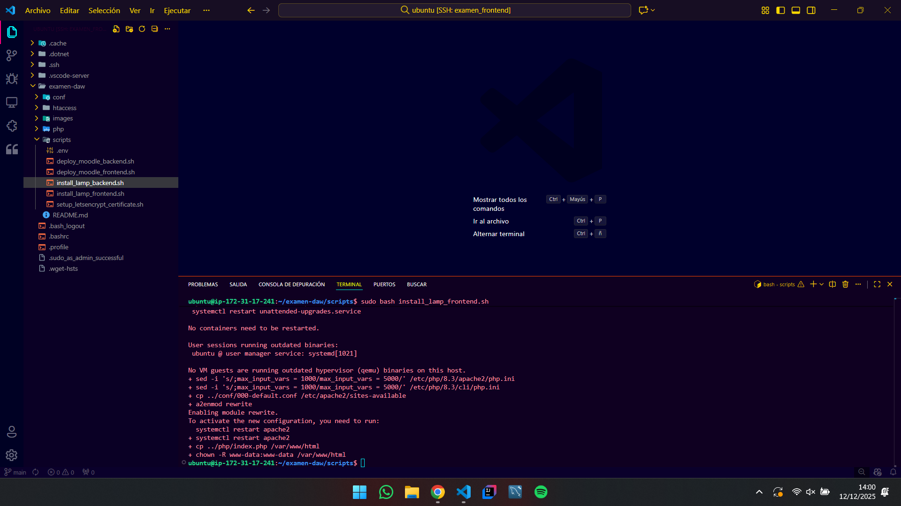

### SetUp_Letsencrypt_Certificate
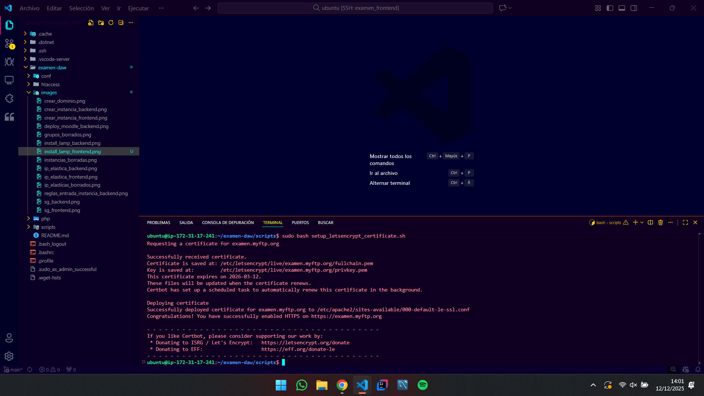

### Deploy_Moodle_Frontend
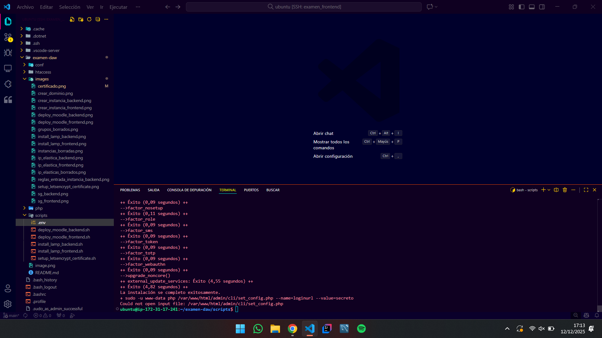

### Pagina Principal
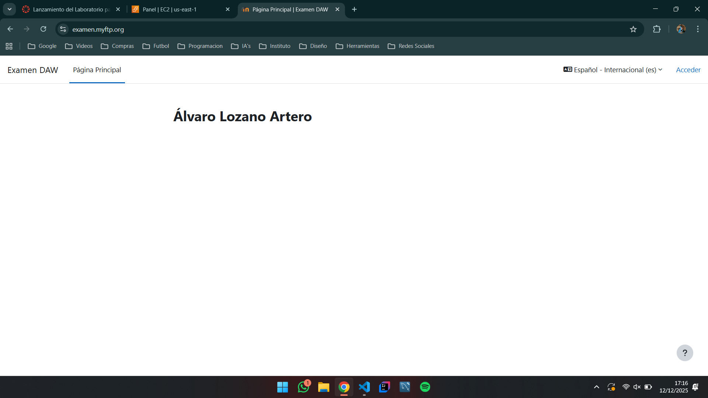

### Certificado
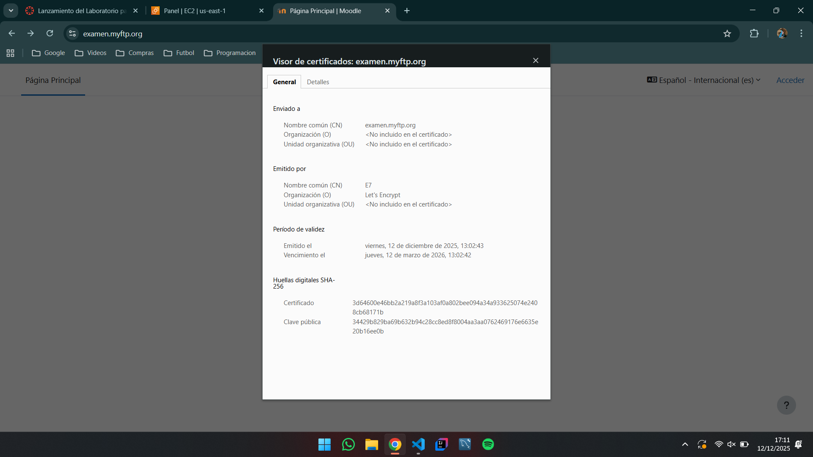

### Login
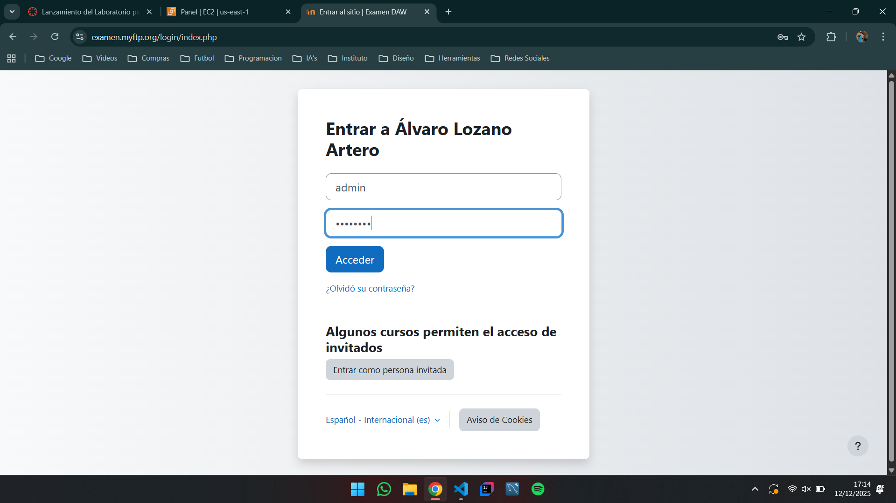

### Dashboard Moodle
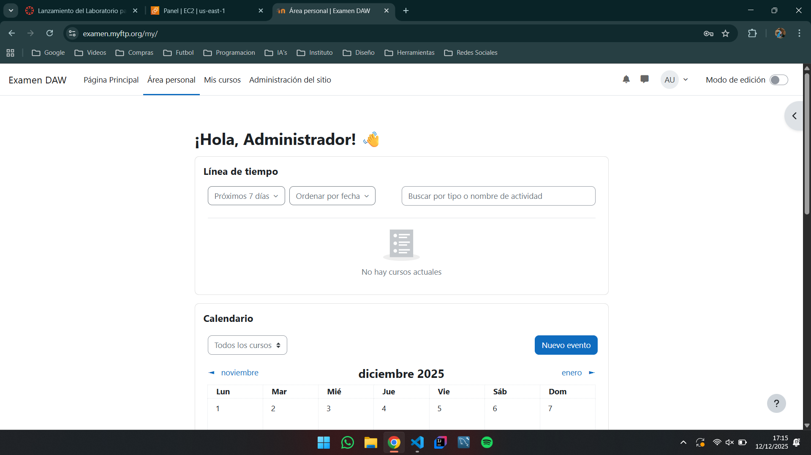